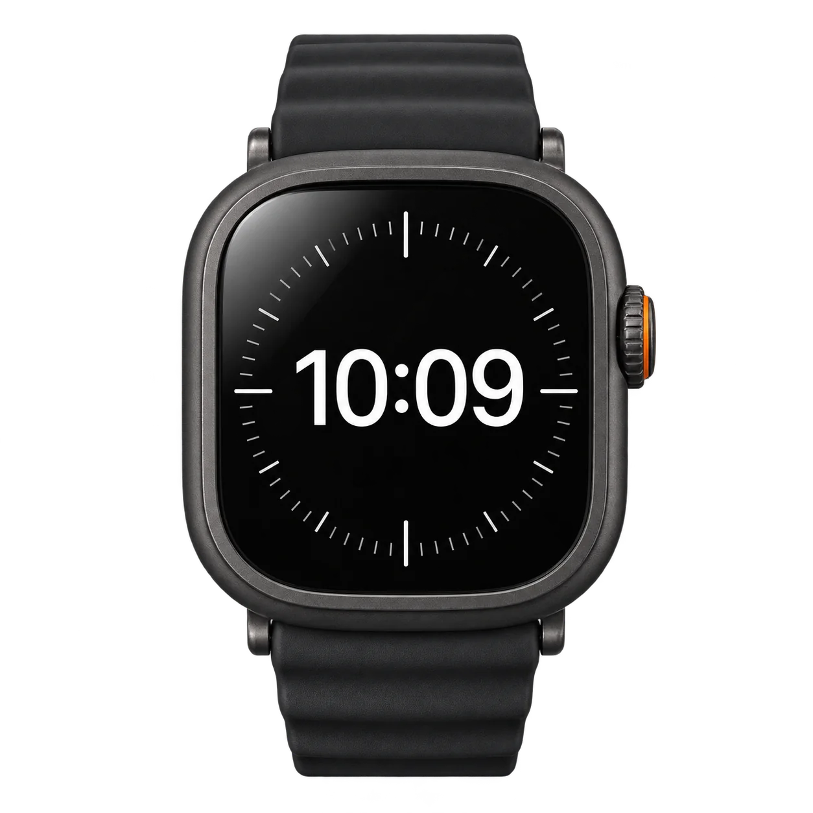
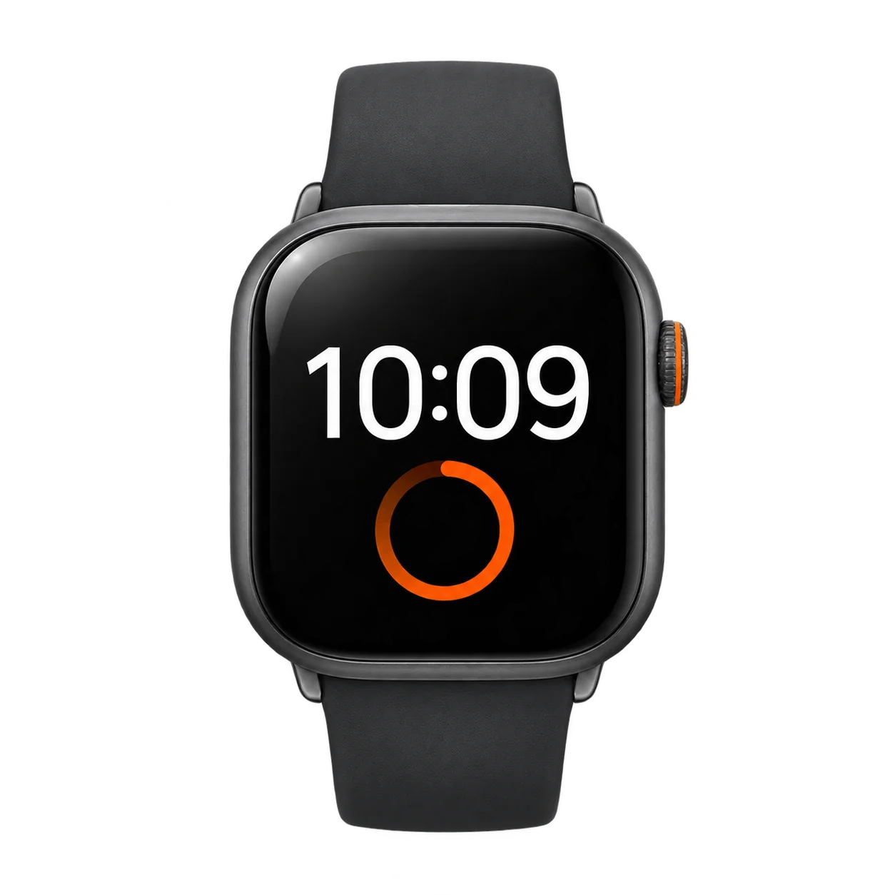
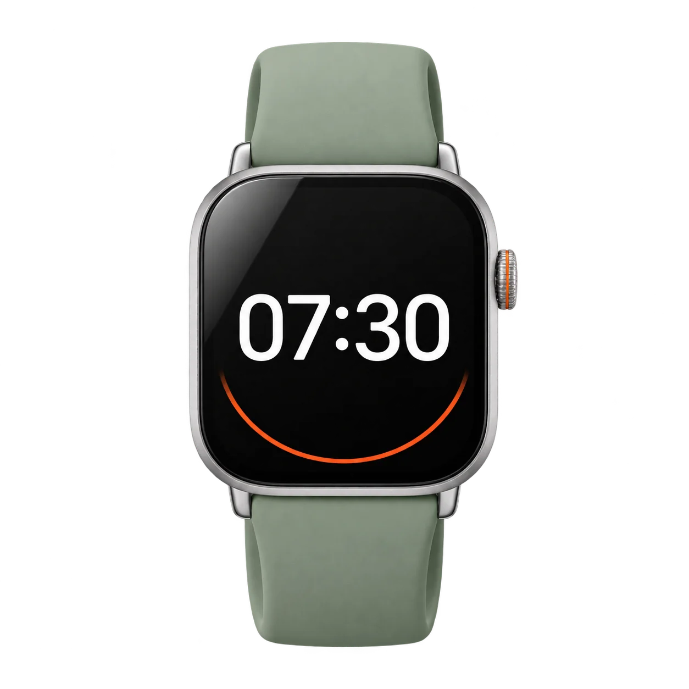
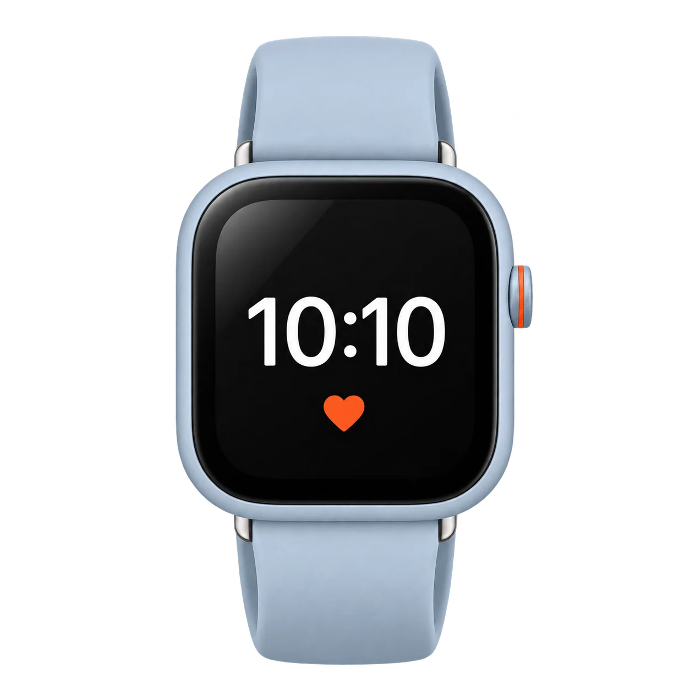
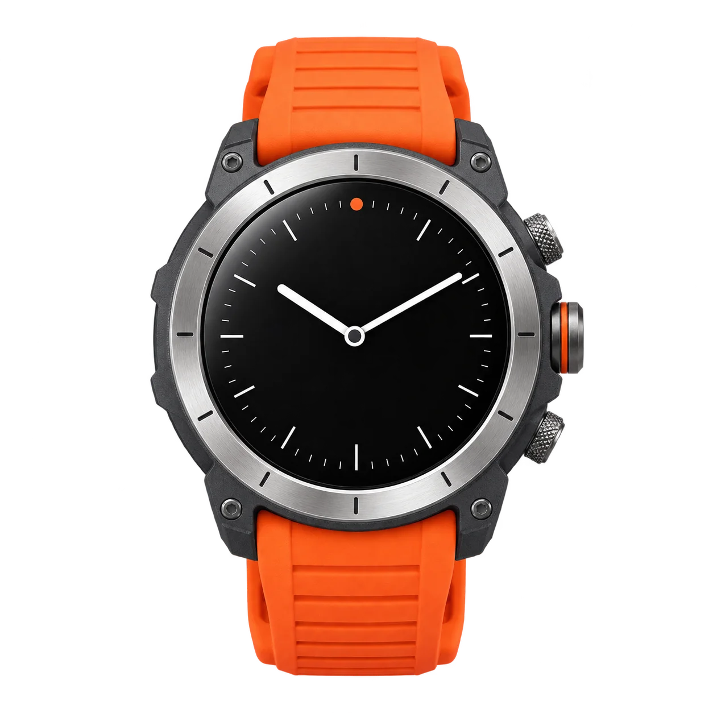
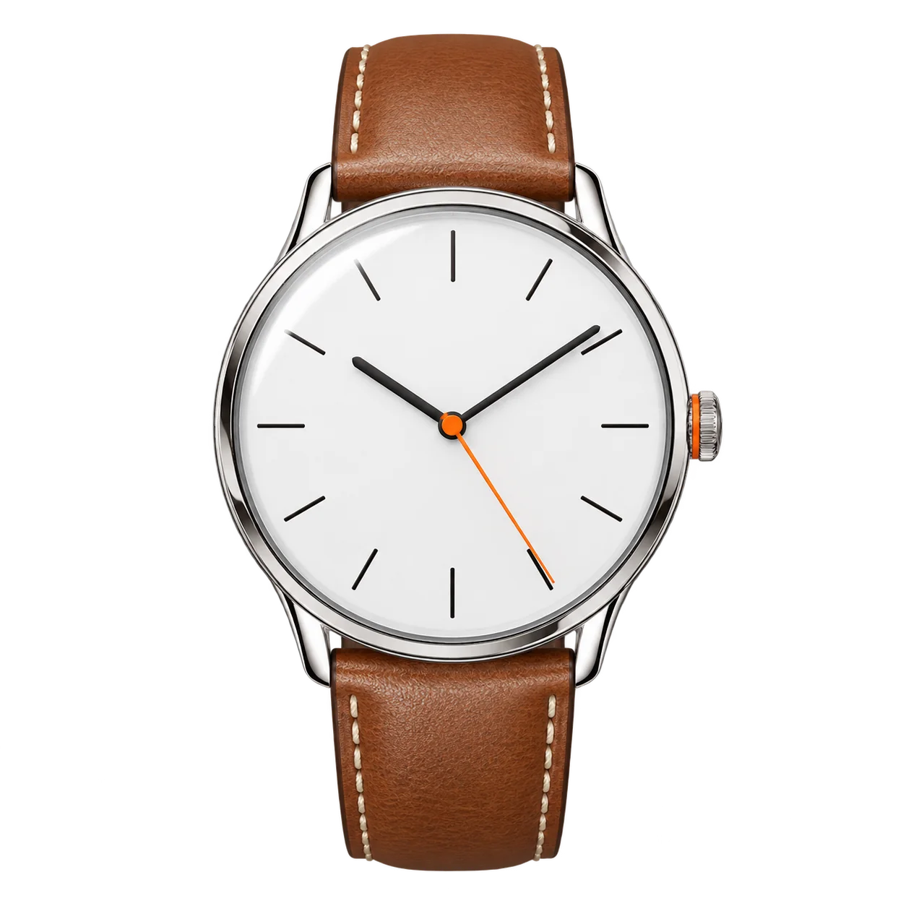

# Chrona

REST API untuk marketplace smartwatch fiktif Chrona.


</div>

---

Berisi data 20 smartwatch dalam enam seri, akun pengguna dengan login JWT, dan hak akses admin untuk mengelola produk. Frontend belum ada.

## Katalog

<table>
  <tr>
    <td align="center"><br /><b>Pulse Pro</b><br />Rp3.799.000</td>
    <td align="center"><br /><b>Pulse</b><br />mulai Rp1.799.000</td>
    <td align="center"><br /><b>Active</b><br />mulai Rp1.299.000</td>
  </tr>
  <tr>
    <td align="center"><br /><b>Lite</b><br />mulai Rp699.000</td>
    <td align="center"><br /><b>Trail</b><br />mulai Rp2.799.000</td>
    <td align="center"><br /><b>Classic</b><br />mulai Rp2.499.000</td>
  </tr>
</table>

## Menjalankan

Butuh Node.js 18+ dan MongoDB (lokal di port 27017 atau Atlas).

```bash
cd server
npm install
cp .env.example .env   # lalu isi JWT_SECRET dan akun admin
npm run seed           # isi 20 produk + akun admin
npm run dev
```

API berjalan di `http://localhost:5050`.

> [!NOTE]
> Port 5050 dipakai karena port 5000 sering diblokir Windows (`EACCES`).

`JWT_SECRET` wajib diisi, bisa dibuat dengan:

```bash
node -e "console.log(require('crypto').randomBytes(32).toString('hex'))"
```

## Endpoint

**Produk**

| Method | Path | Akses |
|---|---|---|
| `GET` | `/api/products` | publik |
| `GET` | `/api/products/:key` | publik |
| `POST` | `/api/products` | admin |
| `PUT` | `/api/products/:key` | admin |
| `DELETE` | `/api/products/:key` | admin |

**Pengguna**

| Method | Path | Akses |
|---|---|---|
| `POST` | `/api/users/register` | publik |
| `POST` | `/api/users/login` | publik |
| `GET` | `/api/users/me` | login |
| `GET` | `/api/users` | admin |
| `GET` | `/api/users/:id` | admin / pemilik |
| `PUT` | `/api/users/:id` | admin / pemilik |
| `DELETE` | `/api/users/:id` | admin |

- `:key` bisa berupa nomor produk (`3`), slug (`chrona-pulse-45-graphite`), atau `_id`.
- Filter daftar produk: `tag`, `series`, `sort` (`newest`, `price-asc`, `price-desc`, `best-selling`), `limit`.
- Token dikirim lewat header `Authorization: Bearer <token>`.
- Gambar produk tersedia di `/images/products/<slug>.webp`.

---

<sub>Chrona adalah merek fiktif. Nama produk, harga, dan spesifikasi dibuat sendiri untuk keperluan latihan.</sub>
